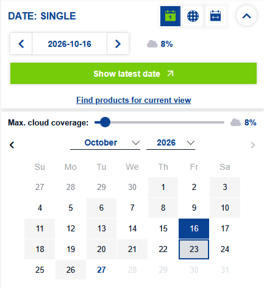
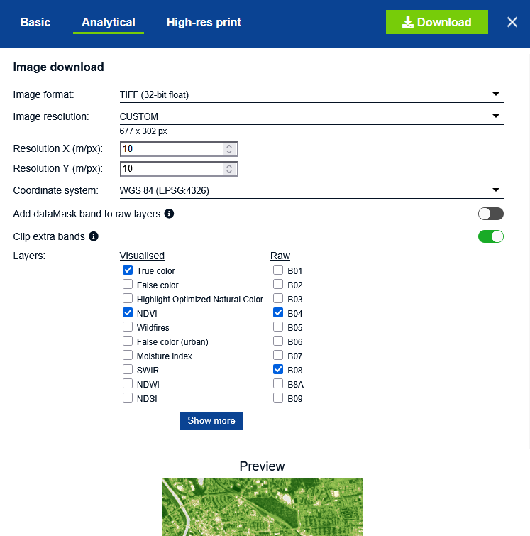
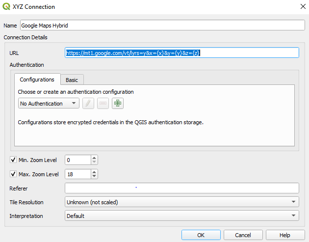
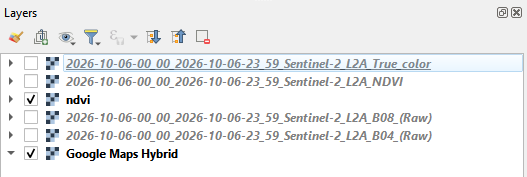
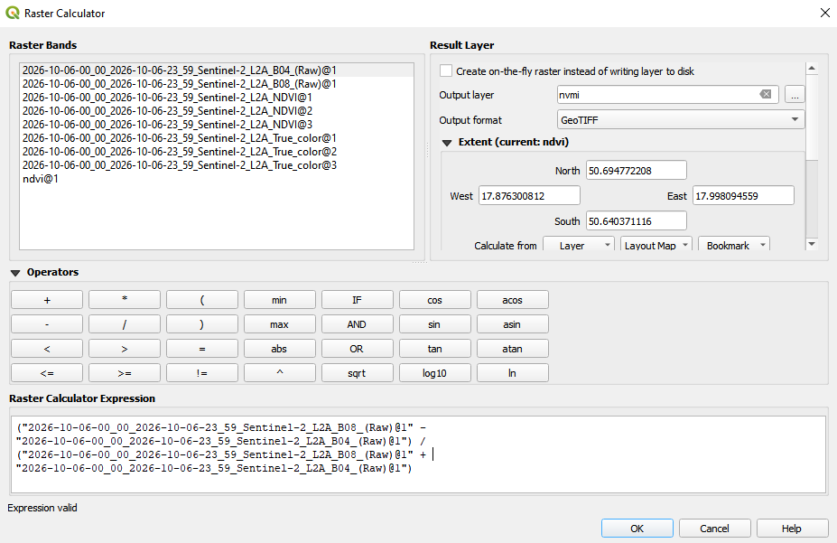
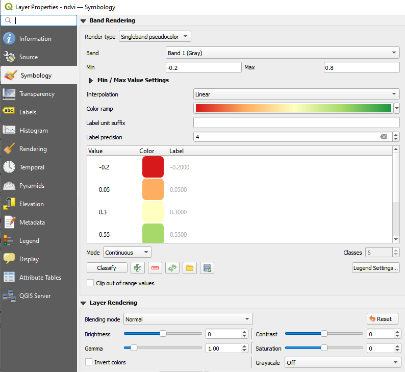
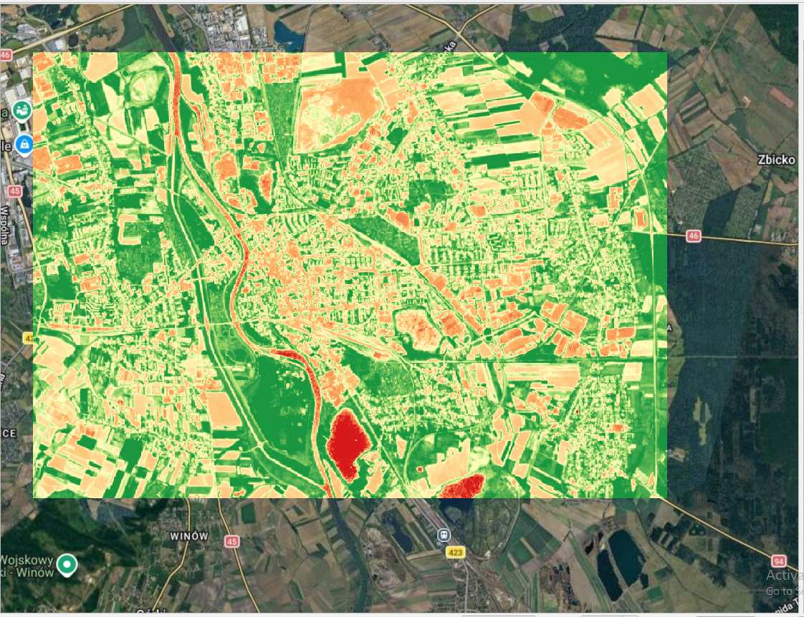

# Analiza danych prestrzennych: Laboratiorium 1

> - Autor: Tobiasz Sleziona
> - Nr dziennika: 103868
> - Data zajęć: 13/10/2026

## Narzędzia
Narzędzia użyte w tym laboratorium:
- **Przeglądarka Copernicus** -- do pobrania surowych danych przestrzennych
- **QGIS** -- do skomponowania oraz analizy danych z przeglądarki Copernicus
- **Google Maps** (przez QGIS)

## Pobranie danych z przeglądarki Copernicus

1. Przed rozpoczęciem pracy, utworzono konto na przeglądarce Copernicus. Jest to wymagane, ponieważ 
Copernicus nie pozwala na pobieranie danych analitycznych dla użytkowników anonimowych.
2. Wybrano obszar Opola, z którego zostaną pobrane dane przestrzenne, oraz satelitę Sentinel-2.
3. Wybrano datę z małym procentem zachmurzenia (~10%): Ostatecznie wybrano datę **2016-10-16**. 

4. Pobrano dane analityczne o tych cechach:
- **Image format**: (TIFF (32-bit float))
- **Image resolution**: CUSTOM
  - **Resolution X / Resolution Y**: 10 / 10
- **Layers**: Wybrano "True Color" oraz "NDVI" do porównania finalnych danych z QGIS z danymi rzeczywistymi,
oraz BO4 orz B08, które są kanałami R (Red) oraz NIR (Near InfaRed), potrzebne do obliczenia własnego NDVI.

5. Dane zostały otrzymane w folderze ZIP. Zdjęcia TIFF odpakowano do własnego folderu.

## QGIS oraz obliczenie NDVI

1. Pobrano oraz zainstalowano program QGIS oraz utworzono nowy projekt o nazwie `lab.qgz`.
2. Połączono mapę "Google Maps Hybrid" z Google Maps poprzez dodanie nowego połączenia pod linkiem "https://mt1.google.com/vt/lyrs=y&x={x}&y={y}&z={z}" 

3. Skopiowano dane analityczne z przeglądarki Copernicus do programu QGIS + dodano mapę Google maps jako warstwę 
(warstwa ndvi została oblicznona w późniejszym kroku).

4. Utworzono obliczeniową warstwę "nvmi" poprzez opcję "Raster Calculator..."  
> Górne menu programu > Raster > Raster Calculator

Użyto wzoru: 

$$ NDVI = { (NIR - RED) \over (NIR + RED) } $$ 

lub używając metryk podanych przez satelity Sentinel-2:

$$ NDVI = { (B08 - B04) \over (B08 + B04) } $$

Wskaźnik **NDVI** (ang. Normalized Difference  Vegetation Index) jest miarą roślinności. Opiera się na zasadzie, że
zdrowe liście oraz chlorofil w nich zawarty pochłaniają znaczną część promieniowania czerwonego,
natomiast odbijają promieniowanie bliskiej podczerwieni.

Wynik powyższego wzoru jest znormalizowany, czyli mieści się w przedziale [-1, 1].

5. Zmieniono właściwości warstwy: "Band rendering" na "Singleband pseudocolor", oraz użyto trzy-kolorowy zakres:
Czerwony-żółty-zielony. Wartości "Min" oraz "Max" ustawiono na sensowne wartości ukazujące kontrast obszaru między
terenami zabudowanymi a zielonymi: [-0.2, 0.8]

Finalne zdjęcie warstwy "ndvi" na mapie Google Maps:

