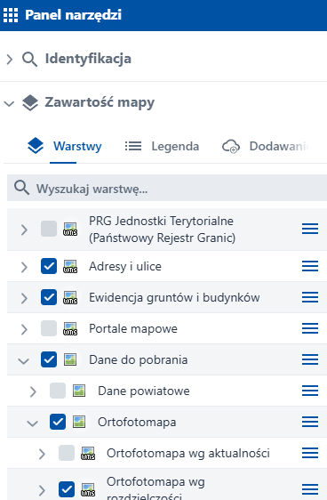
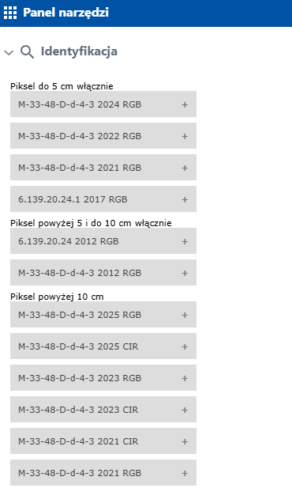
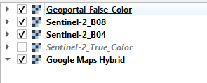
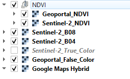
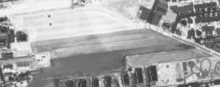
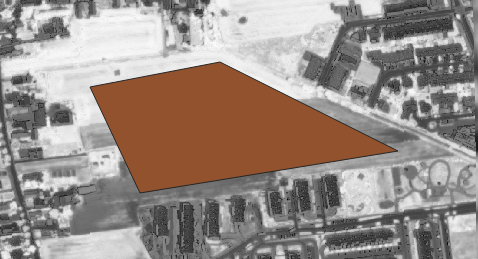
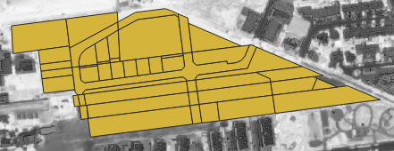
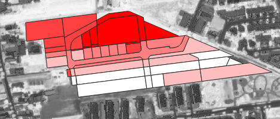
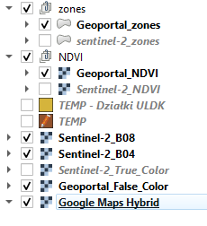

# Analiza danych prestrzennych: Laboratiorium 2

> - Autor: Tobiasz Sleziona
> - Nr dziennika: 103868
> - Data zajęć: 20/10/2026

## Narzędzia
Narzędzia użyte w tym laboratorium:
- **Przeglądarka Copernicus** -- do pobrania surowych danych przestrzennych
- **QGIS** -- do skomponowania oraz analizy danych z przeglądarki Copernicus
- **Google Maps** (przez QGIS)
- **geoportal.gov.pl**
- **Wtyczka GIS Support** -- do pobrania danych o działkach

## Pobranie danych z przeglądarki Copernicus

> Proces pobrania danych jest taki sam jak w lab1.

1. Wybrano obszar Opola, z którego zostaną pobrane dane przestrzenne, oraz satelitę Sentinel-2.
2. Wybrano datę z małym procentem zachmurzenia (~10%).
3. Pobrano dane analityczne o tych cechach:
- **Image format**: (TIFF (32-bit float))
- **Image resolution**: CUSTOM
  - **Resolution X / Resolution Y**: 10 / 10
- **Layers**: Wybrano "True Color" oraz "NDVI" do porównania finalnych danych z QGIS z danymi rzeczywistymi,
oraz BO4 orz B08, które są kanałami R (Red) oraz NIR (Near InfaRed), potrzebne do obliczenia własnego NDVI.

## Pobranie danych z Geoportal

1. Wybrano obszar Opola, identyczny jak obszar wybrany w przeglądarce Copernicus.
2. Otwarto "Panel Narzędzi", oraz wybrano "Dane do pobrania > Ortofotomapa > Ortofotomapa wg. rozdzielczości". 

3. Kliknięto obszar na mapie oraz wybrano ponownie "ortofotomapa wg. rozdzielczości" z menu "identyfikacja". Pobrano odpowiednią mapę CIR (False Color).

## QGIS: warstwy NDVI oraz pobranie danych działek z wtyczki

1. Pobrano wtyczkę "Wtyczka GIS Support" z menu "Manage and install plugins..." do pobrania danych o działkach.
2. Przeniesiono mapy z obu źródeł do programu QGIS + mapa Google.

3. Utworzono dwie warstwy NVMI dla obu źródeł: HI_RES (od geoportal) oraz LO_RES (od przeglądarki Copernicus). Na zdjęciu warstwa NDVI od Geoportal.

4. Utworzono warstwę tymczasową wektorową. Utworzono zwykły poligon nad działkami, jakie chcemy przeanalizować.

5. Użyto wtyczki do pobrania danych wektorowych o działkach na podstawie warstwy tymczasowej utworzonej w poprzednim punkcie.

6. Obliczono dane przestrzenne dla poszczególnych działek poprzez narzędzia "Zonal Statistics" dla obu warstw NDVI. Wybrano pola zakończone "_mean".
Dla obu wynikowych warstw wektorowych wybrano również styl "Graduated" w "Symbology".

> Finalne warstwy po wykonaniu wszystkich kroków.
> 
> 