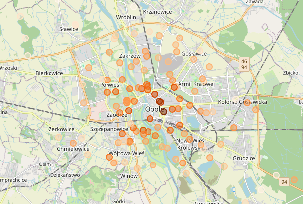
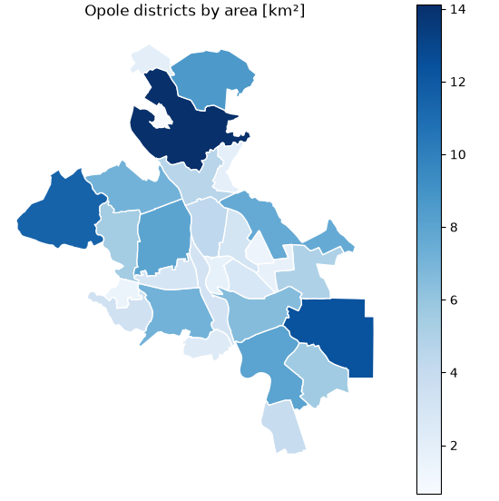
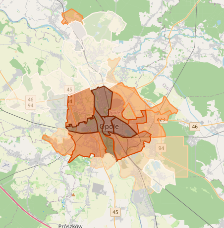
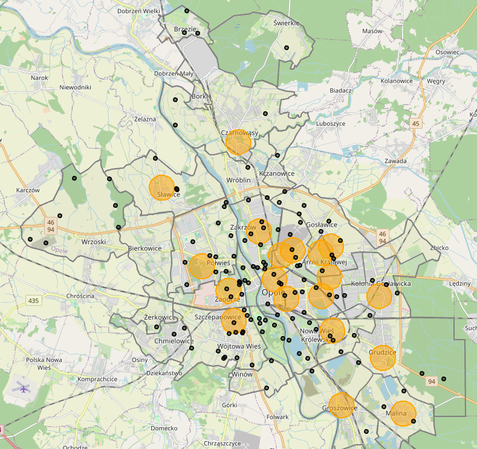
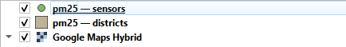
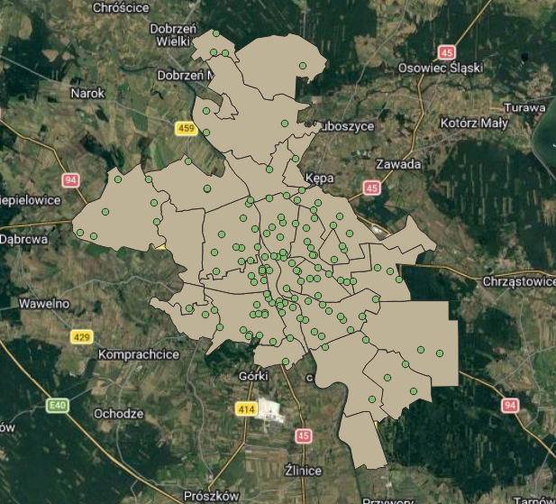

# Analiza danych prestrzennych: Laboratiorium 2

> - Autor: Tobiasz Sleziona
> - Nr dziennika: 103868

## Narzędzia
Narzędzia użyte w tym laboratorium:
- **Jupyter** -- menadżer notatników Jupyter
- **GeoPandas** -- biblioteka python do danych przestrzennych wektorowych
- **QGIS**, **Google Maps**

W tym laboratorium użyto danych sensorowych, dzielnic oraz szkół Opola do wyliczenia wyników na temat zanieczyszczenia
powietrza w poszczególnych dzielnicach oraz w pobliżu szkół.

Oto jak to osiągnięto krok po kroku (szczegóły oraz kod zawarte są w `lab_geopandas.ipynb`):

## Dane sensorów

1. Wczytano dane z pliku `pm25_sensors.csv`
2. wyczyszczono dane: usunięto duplikaty, sensory bez współrzędnych lub z niepoprawnymi danymi (<0) oraz poprawiono 
współrzędne, których szerokości i długości zostały zamienione:

```python
# duplikaty
df = df.drop_duplicates()
...
# dane bez współrzędnych
df = df.dropna(subset=["lat", "lon"])
...
# dane z zamienionymi szerokościami i długościami
swapped = df["lat"].between(14, 24.5) & df["lon"].between(49, 55)
df.loc[swapped, ["lat", "lon"]] = df.loc[swapped, ["lon", "lat"]].to_numpy()
...
# dane z niepoprawnymi wartościami sensorów
df = df[df["pm25"] >= 0].reset_index(drop=True)
```

3. Zamieniono tabele DataFrame na GeoDataFrame:

```python
sensors = gpd.GeoDataFrame(
    df,
    geometry=gpd.points_from_xy(df["lon"], df["lat"]),   # x = lon, y = lat!
    crs="EPSG:4326",
)
```

4. Zamieniono ukł. współrz. z EPSG:4326 (dane stopniowe) na EPSG:2180 -- ukł. współrz. specjalny dla danych Polskich: 
`sensors_m = sensors.to_crs("EPSG:2180")`



## Dzielnice Opola

1. wczytano dane z pliku `opole_districts.geojson`.
2. Zamieniono ukł współrz. na ten sam co ukł. sensorów: **EPSG:2180** w celu obliczenia powierzchni
> bez zamiany na EPSG:2180 dane są w układzie metrowym tylko stopniowym, więc wyliczona powierzchnia nie będzie poprawna.
3. obliczono powierzchnie poszczególnych dzielnic w $km^2$ na podstawie danych w $m^2$.

```python
districts = districts.to_crs("EPSG:2180")           # mandatory!
districts["area_km2"] = districts.area / 1e6        # m² -> km²
```



4. Złączono dane dzielnic z danymi sensorowymi: Każdemu sensorowi przypisana została dzielnica, w której się znajduje.

```python
joined = gpd.sjoin(
    sensors_m,                                   # left: points
    districts[["name", "geometry"]],             # right: polygons (only the columns we need)
    how="left",
    predicate="within",                          # point lies within polygon: sensor lies within district
)
```
5. Obliczono statystyki dzielnic: średnie P25 na podstawie sensorów znajdujących się w dzielnicach oraz liczba sensorów
w dzielnicy:

```python
stats = (joined.groupby("name")                  # name = nazwa dzielnicy
               .agg(pm25_mean=("pm25", "mean"), sensor_count=("pm25", "size"))
               .round(1))

summary = districts.merge(stats, on="name", how="left")
```



(Na diagramie widoczne są dystrykty pokolorowane na podstawie ich średniej wartości P25:
Im ciemniejsze, tym P25 jest większe)

## Szkoły

1. Wczytano dane z pliku: `opole_schools.geojson`.
2. Wyliczono 500-metrowe bufory wokół szkół: okrągłe pola wokół ich lokalizacji.

```python
buffers["geometry"] = schools.buffer(500)
```

3. Złączono dane dzielnic+sensorów z danymi szkół wraz z ich buforami.

```python
near_schools = gpd.sjoin(sensors_m, buffers[["name", "geometry"]], predicate="within")
```


## Wyniki

1. Wszystkie przetworzone dane dzielnic i sensorów zapisano do dwóch formatów:
- **GeoPackage** zawierające zawierające warstwy obu źródeł danych, oraz
- **GeoJSON** zawierające JSON, użyteczne dla aplikacji webowych. 

```python
# GeoPackage: many layers in one file, any CRS - the default choice
summary.to_file(out / "pm25.gpkg", layer="districts", driver="GPKG")
sensors_m.to_file(out / "pm25.gpkg", layer="sensors", driver="GPKG")

# GeoJSON: for web applications - always save it in EPSG:4326
summary.to_crs("EPSG:4326").to_file(out / "pm25_districts.geojson", driver="GeoJSON")
```

2. W celu sprawdzenia poprawności daych, plik GeoPackage otworzono w aplikacji QGIS:



